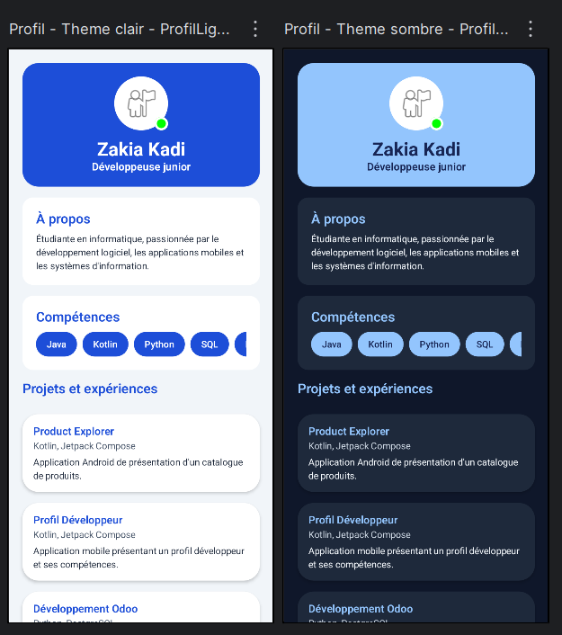
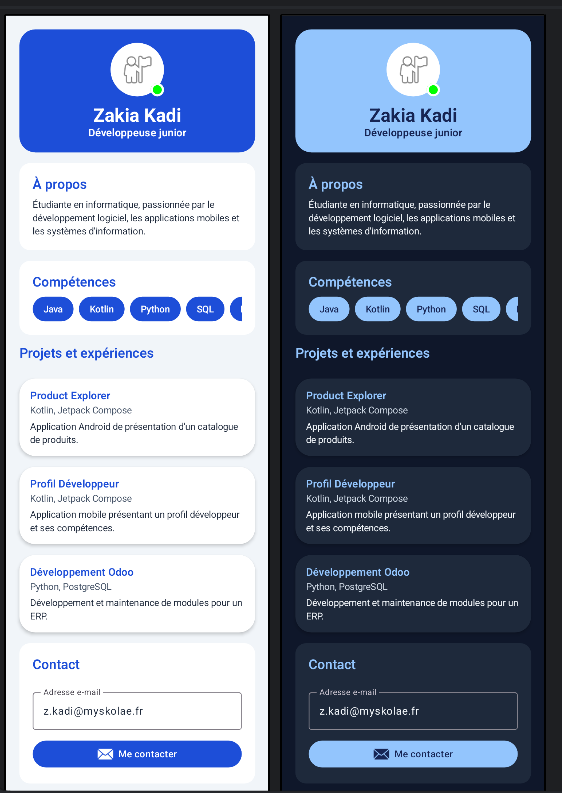

# Profil Développeur 2

## 1. Description de l'application

Profil Développeur 2 est une application Android développée en Kotlin avec Jetpack Compose.

Elle constitue une amélioration de la première version de mon application Profil Développeur. Elle présente mon profil, mes compétences, mes projets, mes expériences et mes informations de contact à travers une interface moderne et adaptée aux thèmes clair et sombre.

Les données sont définies directement dans le code Kotlin.

## 2. Composants Compose utilisés

- `Text` : affichage des textes et des titres.
- `Button` : bouton de contact.
- `Icon` : icône du bouton de contact.
- `Image` : affichage de l'avatar.
- `Card` : présentation des compétences et des projets.
- `OutlinedTextField` : affichage de l'adresse e-mail en lecture seule.

## 3. Layouts utilisés

- `Column` : organisation verticale des éléments.
- `Row` : organisation horizontale des éléments.
- `Box` : superposition de l'avatar et du badge.
- `Spacer` : gestion des espacements.
- `Surface` : organisation des sections de l'interface.
- `LazyColumn` : liste verticale défilante.
- `LazyRow` : liste horizontale défilante.
- `Scaffold` : structure générale de l'application.

## 4. Utilisation de LazyColumn et LazyRow

La `LazyColumn` permet de faire défiler verticalement l'ensemble du profil et d'afficher les différents projets à l'aide du composable réutilisable `ProjetCard()`.

La `LazyRow` permet de faire défiler horizontalement les compétences, affichées à l'aide du composable réutilisable `CompetenceCard()`.

## 5. Choix du thème

J'ai choisi d'utiliser Material Design 3 pour obtenir une interface moderne, simple et cohérente.

Le bleu est utilisé comme couleur principale. Les couleurs sont adaptées aux thèmes clair et sombre pour assurer une bonne lisibilité.

La typographie permet de différencier les titres et les descriptions. Les coins arrondis donnent un aspect homogène aux différentes sections de l'application.

## 6. Captures d'écran

### Avant modification de la hauteur des previews

Cette première capture montre l'application avant modification du paramètre `heightDp`.
L'affichage ne permettait pas de voir l'ensemble du profil dans la preview.

### Après modification de la hauteur des previews

Cette deuxième capture montre l'application après modification du paramètre `heightDp = 1200` dans les deux annotations `@Preview`.  
Elle a permis d'afficher une plus grande partie du profil dans les previews, y compris les sections situées plus bas dans l'écran.

## 7. Notions du chapitre Compose UI réutilisées

**Quelles notions du chapitre Compose UI avez-vous réutilisées dans cette application ?**

J'ai réutilisé les composants fondamentaux de Compose, les layouts, les modifiers, les composables réutilisables, les listes modernes, les paramètres, les callbacks et les previews.

J'ai également appliqué les notions de Material Design 3 concernant les couleurs, la typographie, les formes et les thèmes clair et sombre.

## 8. Fonctionnalités réalisées

### Fonctionnalité 1 - Avatar et badge de disponibilité

J'ai ajouté un avatar et un badge vert afin d'améliorer la présentation du profil.

Pour cette fonctionnalité, je me suis appuyée sur les notions vues en TP pour l'utilisation des images et la superposition des éléments avec `Box`.

### Fonctionnalité 2 - Liste des compétences

J'ai amélioré l'affichage des compétences en utilisant une liste horizontale défilante et des cartes réutilisables.

### Fonctionnalité 3 - Liste des projets et expériences

J'ai ajouté une section présentant mes projets, les technologies utilisées et une courte description de chaque projet.

Je me suis appuyée sur l'utilisation de `LazyColumn` et des cartes réutilisables.

### Fonctionnalité 4 - Section contact

J'ai amélioré la section contact en ajoutant un champ en lecture seule pour l'adresse e-mail ainsi qu'une icône accompagnant le bouton de contact.

### Fonctionnalité 5 - Personnalisation des couleurs

J'ai défini deux palettes de couleurs afin d'adapter l'interface aux thèmes clair et sombre.

### Fonctionnalité 6 - Personnalisation de la typographie

J'ai personnalisé les styles des textes afin d'améliorer la lisibilité et de différencier les titres des descriptions.

### Fonctionnalité 7 - Personnalisation des formes

J'ai personnalisé les coins arrondis des cartes et des différentes sections afin d'obtenir une interface homogène.

### Fonctionnalité 8 - Previews claire et sombre

J'ai créé deux previews permettant de visualiser le même profil en thème clair et en thème sombre.
